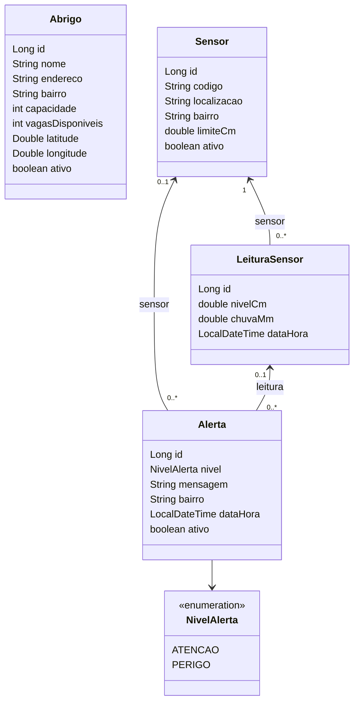

# Rota Segura API 🌧️

API REST de alerta de enchentes desenvolvida para a **Global Solution FIAP** (disciplina de Java).

**Link do deploy:** `https://SEU-APP.onrender.com/swagger-ui.html` *(substituir após o deploy)*

---

## 📌 O problema

No **Jardim Pantanal** (zona leste de São Paulo, na várzea do Rio Tietê) e em outros bairros de risco, em períodos de chuva forte, córregos urbanos transbordam rapidamente e os moradores das áreas de risco muitas vezes só percebem quando a água já entrou em casa. Falta um aviso antecipado e uma informação simples: **para onde ir?**

O **Rota Segura** resolve isso assim:

1. **Sensores** instalados nos córregos enviam leituras do nível da água (em cm) e da chuva (em mm).
2. Quando o nível chega perto ou passa do **limite do sensor**, o sistema gera um **alerta** para o bairro:
   - **ATENCAO** → nível ≥ 80% do limite
   - **PERIGO** → nível ≥ limite
3. Junto com o alerta, a API devolve os **abrigos ativos com vagas** no bairro.
4. A Defesa Civil também pode criar alertas manualmente e encerrá-los quando o risco passar.

**ODS relacionados:**
- **ODS 11** – Cidades e comunidades sustentáveis (reduzir o impacto de desastres nas cidades)
- **ODS 13** – Ação contra a mudança global do clima (adaptação a eventos climáticos extremos)

---

## 👥 Integrantes

| Nome | RM |
|------|----|
| Bernardo Yuji Rodriguez Hanashiro | RM565266 |
| Matheus Vasques | RM563309 |

Turma: **ESPW** · Grupo: **Rota Segura**

---

## 🛠️ Tecnologias

- Java 21
- Spring Boot 3 (Web, Data JPA, Validation)
- Banco de dados Oracle (FIAP)
- H2 em memória (somente no profile `prod`, caso o Render não acesse o Oracle)
- Springdoc OpenAPI (Swagger UI)
- Maven
- Docker
- Render (deploy)

---

## 📁 Estrutura do projeto

```
rota-segura-api
├── src/main/java/br/com/fiap/rotasegura
│   ├── controller      # recebe as requisições HTTP
│   ├── bo              # camada BO: regras de negócio
│   ├── dao             # camada DAO: acesso ao banco (Spring Data JPA)
│   ├── model           # entidades JPA
│   ├── dto             # records de entrada e saída
│   ├── exception       # exceções e tratamento global de erros
│   └── DadosIniciais.java  # carga de dados de exemplo
├── src/main/resources
│   ├── application.properties       # configuração padrão (Oracle)
│   └── application-prod.properties  # profile prod (H2)
├── script.sql          # DDL das tabelas
├── requests.http       # requisições prontas para testar
├── Dockerfile
└── .env.example
```

---

## 🧩 Diagrama de classes



> O `Abrigo` não tem relacionamento direto: ele é ligado ao alerta pelo **bairro**.

### Tabelas no Oracle

| Entidade | Tabela |
|----------|--------|
| Abrigo | `TB_RS_ABRIGO` |
| Sensor | `TB_RS_SENSOR` |
| LeituraSensor | `TB_RS_LEITURA` |
| Alerta | `TB_RS_ALERTA` |

O DDL completo está em [`script.sql`](script.sql). As tabelas também são criadas automaticamente pelo Hibernate (`ddl-auto=update`).

---

## 🔐 Variáveis de ambiente

A aplicação **não tem nenhuma credencial no código**. Ela lê:

| Variável | Descrição | Exemplo |
|----------|-----------|---------|
| `DB_URL` | URL JDBC do Oracle (opcional, já tem o padrão da FIAP) | `jdbc:oracle:thin:@oracle.fiap.com.br:1521:ORCL` |
| `DB_USER` | Usuário do Oracle (seu RM) | `rm123456` |
| `DB_PASSWORD` | Senha do Oracle | `********` |
| `PORT` | Porta HTTP (opcional, padrão 8080) | `8080` |
| `SPRING_PROFILES_ACTIVE` | Use `prod` só se precisar do H2 no deploy | `prod` |

### Rodando local com arquivo `.env`

1. Copie o arquivo de exemplo:
   ```bash
   cp .env.example .env
   ```
   (no Windows: `copy .env.example .env`)
2. Abra o `.env` e preencha seu RM e senha.
3. Pronto! A aplicação lê o `.env` automaticamente ao iniciar (`spring.config.import` no `application.properties`).

> ⚠️ O `.env` está no `.gitignore` e **nunca** deve ser enviado ao GitHub.

---

## ▶️ Como rodar local

Pré-requisitos: **Java 21** e **Maven**.

```bash
mvn spring-boot:run
```

Acesse:
- Swagger UI: http://localhost:8080/swagger-ui.html
- API: http://localhost:8080/abrigos

Para rodar **sem Oracle** (H2 em memória), use o profile `prod`:

```bash
mvn spring-boot:run -Dspring-boot.run.profiles=prod
```

Ao iniciar, a classe `DadosIniciais` cadastra dados de exemplo **somente se as tabelas estiverem vazias** (3 bairros, 4 abrigos, 3 sensores e 5 leituras).

---

## 🐳 Como rodar com Docker

```bash
docker build -t rota-segura-api .
```

```bash
docker run -p 8080:8080 --env-file .env rota-segura-api
```

Ou, sem Oracle (H2):

```bash
docker run -p 8080:8080 -e SPRING_PROFILES_ACTIVE=prod rota-segura-api
```

---

## ☁️ Deploy no Render

1. Suba o projeto para um repositório no GitHub (o `.env` não vai junto).
2. Acesse [render.com](https://render.com) e entre com sua conta do GitHub.
3. Clique em **+ New → Web Service** e selecione o repositório.
4. Configure:
   - **Language:** `Docker`
   - **Branch:** `main`
   - **Root Directory:** deixe vazio (ou `rota-segura-api`, se o projeto estiver numa subpasta do repositório)
   - **Instance Type:** `Free`
5. Em **Environment Variables**, adicione `DB_URL`, `DB_USER` e `DB_PASSWORD`.
6. Clique em **Deploy Web Service** e acompanhe os logs (o primeiro build leva alguns minutos).
7. Quando aparecer `Started RotaSeguraApiApplication`, acesse `https://SEU-APP.onrender.com/swagger-ui.html`.

**Se o log mostrar timeout ao conectar no Oracle** (ex: `IO Error: The Network Adapter could not establish the connection`), adicione a variável `SPRING_PROFILES_ACTIVE` = `prod`. O Render faz o redeploy sozinho e a API passa a usar H2 em memória (os dados voltam ao exemplo a cada reinício).

> No plano free o serviço "dorme" após 15 minutos sem acesso. A primeira requisição depois disso pode levar cerca de 1 minuto.

---

## 🔗 Endpoints

### Abrigos

| Método | Rota | Descrição | Sucesso |
|--------|------|-----------|---------|
| GET | `/abrigos` | Lista todos os abrigos | 200 |
| GET | `/abrigos/{id}` | Busca abrigo por id | 200 |
| GET | `/abrigos/bairro/{bairro}` | Abrigos ativos com vaga no bairro | 200 |
| POST | `/abrigos` | Cadastra abrigo | 201 |
| PUT | `/abrigos/{id}` | Atualiza abrigo | 200 |
| DELETE | `/abrigos/{id}` | Exclui abrigo | 204 |

### Sensores

| Método | Rota | Descrição | Sucesso |
|--------|------|-----------|---------|
| GET | `/sensores` | Lista todos os sensores | 200 |
| GET | `/sensores/{id}` | Busca sensor por id | 200 |
| GET | `/sensores/{id}/leituras` | Histórico de leituras do sensor | 200 |
| POST | `/sensores` | Cadastra sensor | 201 |
| PUT | `/sensores/{id}` | Atualiza sensor | 200 |
| DELETE | `/sensores/{id}` | Exclui sensor (só se não tiver leituras) | 204 |

### Leituras

| Método | Rota | Descrição | Sucesso |
|--------|------|-----------|---------|
| POST | `/leituras` | Registra leitura e gera alerta se necessário | 201 |

### Alertas

| Método | Rota | Descrição | Sucesso |
|--------|------|-----------|---------|
| GET | `/alertas` | Lista todos os alertas | 200 |
| GET | `/alertas/ativos` | Lista alertas ativos | 200 |
| GET | `/alertas/{id}` | Busca alerta por id | 200 |
| POST | `/alertas` | Cria alerta manual (Defesa Civil) | 201 |
| PUT | `/alertas/{id}/encerrar` | Encerra o alerta (`ativo = false`) | 200 |
| DELETE | `/alertas/{id}` | Exclui alerta | 204 |

### Erros

Todos os erros seguem o mesmo formato:

```json
{
  "status": 404,
  "mensagem": "Sensor não encontrado com código SNS-999",
  "timestamp": "2026-11-17T14:30:00.123"
}
```

| Situação | Status |
|----------|--------|
| Registro ou rota não encontrada | 404 |
| Campos inválidos (Bean Validation) ou JSON mal formatado | 400 |
| Parâmetro da URL com tipo errado (ex: `/abrigos/abc`) | 400 |
| Regra de negócio (ex: sensor inativo, código repetido) | 400 |
| Método HTTP não suportado na rota | 405 |
| Violação de restrição do banco | 409 |
| Erro inesperado | 500 |

---

## 📨 Exemplos de requisição

O arquivo [`requests.http`](requests.http) tem **todas** as requisições prontas (IntelliJ ou VS Code com a extensão REST Client).

### POST /leituras — regra principal

O sensor `SNS-001` tem limite de **180 cm** (ATENCAO a partir de 144 cm).

**Gera PERIGO** (185 ≥ 180):

```json
{
  "codigoSensor": "SNS-001",
  "nivelCm": 185.0,
  "chuvaMm": 42.5
}
```

Resposta `201 Created`:

```json
{
  "leitura": {
    "id": 6,
    "codigoSensor": "SNS-001",
    "nivelCm": 185.0,
    "chuvaMm": 42.5,
    "dataHora": "2026-11-17T14:30:00.123"
  },
  "alerta": {
    "id": 1,
    "nivel": "PERIGO",
    "mensagem": "PERIGO: o córrego em Córrego Três Pontes - ponte da Rua das Flores atingiu 185.0 cm (limite 180.0 cm). Procure um abrigo no bairro Jardim Pantanal.",
    "bairro": "Jardim Pantanal",
    "dataHora": "2026-11-17T14:30:00.130",
    "ativo": true,
    "codigoSensor": "SNS-001",
    "leituraId": 6
  },
  "abrigosDisponiveis": [
    {
      "id": 1,
      "nome": "EMEF Jardim Pantanal",
      "endereco": "Rua das Acácias, 120",
      "bairro": "Jardim Pantanal",
      "capacidade": 150,
      "vagasDisponiveis": 120,
      "latitude": -23.4952,
      "longitude": -46.4318,
      "ativo": true
    }
  ]
}
```

**Gera ATENCAO** (150 ≥ 144):

```json
{
  "codigoSensor": "SNS-001",
  "nivelCm": 150.0,
  "chuvaMm": 20.0
}
```

**Não gera alerta** (90 < 144) — a resposta vem com `"alerta": null` e `"abrigosDisponiveis": []`:

```json
{
  "codigoSensor": "SNS-001",
  "nivelCm": 90.0,
  "chuvaMm": 3.0
}
```

### POST /abrigos

```json
{
  "nome": "Paróquia São José",
  "endereco": "Rua da Matriz, 300",
  "bairro": "Jardim Helena",
  "capacidade": 100,
  "vagasDisponiveis": 100,
  "latitude": -23.4861,
  "longitude": -46.4221,
  "ativo": true
}
```

### POST /sensores

```json
{
  "codigo": "SNS-004",
  "localizacao": "Córrego Três Pontes - foz no Tietê, Rua do Lago",
  "bairro": "Jardim Pantanal",
  "limiteCm": 160.0,
  "ativo": true
}
```

### POST /alertas (manual)

```json
{
  "sensorId": 2,
  "nivel": "PERIGO",
  "mensagem": "Defesa Civil: Rua do Porto alagada. Moradores devem ir ao Salão Comunitário Jardim Helena.",
  "bairro": "Jardim Helena"
}
```

> `sensorId` é opcional. `nivel` aceita `ATENCAO` ou `PERIGO`.
